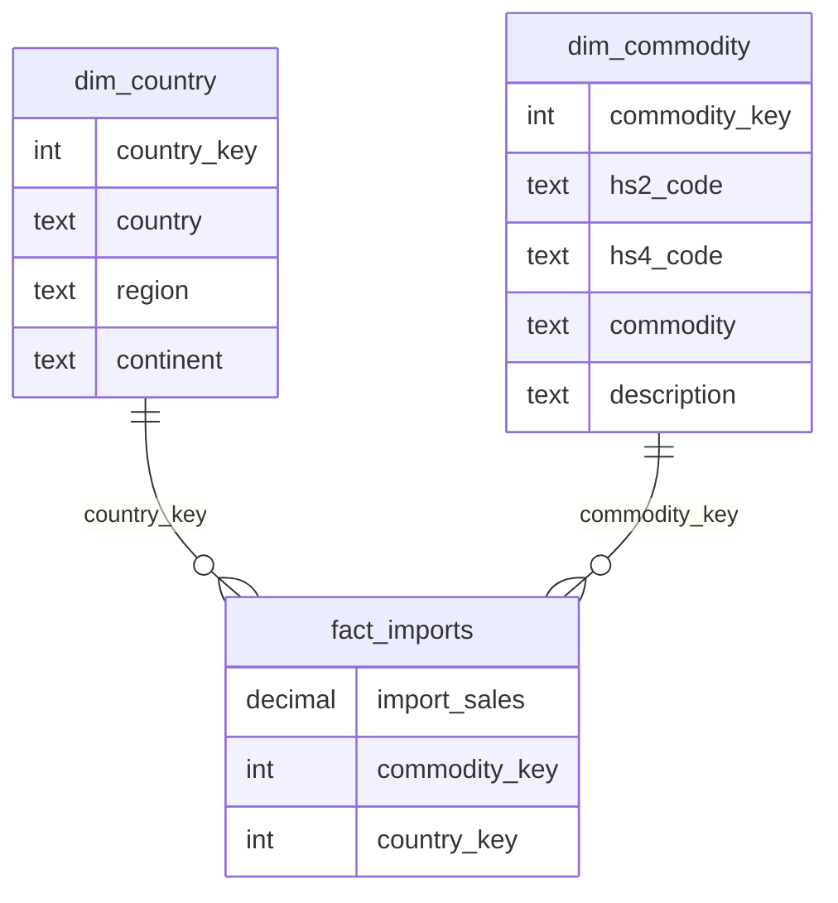

# India Import Data Analysis Project

### Introduction
Project tries to visually show what we import and from where. On what countries are we highly dependent on? Project doesn't revolve around why we should not be dependent 
it just shows commodities for which imports should be diversified to other countries.

### Data Source
Website Link: https://tradestat.commerce.gov.in/eidb/commodity_wise_export
Owner: Ministry of Commerce and Industry. Government of India

Raw excel files downloaded are inside the Data --> raw folder. You can download same data from the website. Data used are Country Wise, Commodity Wise, All commodities country wise,
Country wise all commodities, Region wise all countries. 

Website contains data of last 8 years but this project just uses 2025-2026 import data. And constraint is that there are more then 200 countries and each has a separate data file.
But top 59 countries from India imports more than $1 Billion worth of commodities and represent more than 90% of all the imports. So total imports stand at around $775 Biilion. 
And 59 countries account to around $750+ Billion. So, all 200+ country were not included and only data of 59 countries was used. And 
those countries each account to more than $1 Billion in yearly trade. 

Country names, Continent division, Region division used by this website is very different from what we see in real world. Example Australia is not another continent but part
of Asia and so on. And China is not named as China it is named as CHINA P RP. Project tries to preserve the naming convention of commodities and countries used in the data by the government.

### Data Cleaning
Pandas a python library is used for data cleaning purpose and 59 excel sheets of All commodity x Each Country were merged together using power query feature available in excel. All the jupyter notebooks are present
in the Notebooks folder with comments and can be referred. 

### Schema Design
Star schema design was followed. Two-dimension tables dim_country and dim_commodity was created, and fact_imports tables was created. All the cleaned data files are present under Data --> Processed folder
Diagram will be added here later. 

### Database
PostgreSQL image is created and Docker is used to create a container where it is running locally. docker-compose.yaml file is present inside the Database folder for the PostgreSQL image. DBeaver an open-source Universal Database Manager is connected with the container running in docker. Internet search and AI can easily help with the setup. Schema was created first and then tables were loaded. SQL Scripts
folder provides all the SQL Scripts used throughout the project.

### Business Question
Project has answered around 10 to 15 business questions using SQL. A presentation file is present inside the project which shows the questions, queries, responses. (Currently under process)

### Power BI Report
Project end goal was to provide a visual look into the data. For that free version of Power BI is used. 3 Page simple report. Power BI folder inside the project contains the report
in different formats.

Content Below this line is AI generated. To provide better insight into what the project is. 

# India Import Analysis: Where Does India Depend on a Single Supplier?

An end-to-end data analysis of India's commodity-wise imports for FY 2025-26, built from public government trade data. The project cleans the raw data with Python, models it as a star schema in PostgreSQL, and presents the findings in a 3-page Power BI report.

**Business question:** For which products does India rely on one country for most of its imports, and where is diversification realistic?

---

## Key findings

| Finding | Value |
|---|---|
| Total imports (FY 2025-26, 59 source countries) | USD 752,877 Mn (about USD 753 bn) |
| Largest source country | China, 17.5% of total imports (USD 131,620 Mn) |
| Region concentration | Asia supplies 69.3% of import value |
| Products where one country supplies more than 60% (HS4, imports of at least USD 100 Mn) | 103 products, about USD 69 bn, roughly 9% of total imports |
| China's role in those 103 products | Top supplier in 68 of them, 46.8% of their combined value |
| Largest dependent products | Batteries (HS 8507): USD 5.6 bn, China 78%. Flat panel display modules (HS 8524): USD 5.6 bn, China 62% |
| Pattern | The largest import categories (fuels, gems and precious metals, machinery) are spread across many suppliers. The dependence is concentrated in specific mid-sized products, not across the whole import basket. |

**Recommendation in brief:** prioritise batteries and flat panel display modules. Flat panels have an established alternative in Vietnam (14% of supply), so a near-term shift is plausible. For batteries, the next suppliers after China are small (Hong Kong 8%, Korea 3%, Vietnam 3%, Japan 2%), so diversification would mean building new suppliers over a longer horizon.

---

## Dashboard

**Page 1: Overview.** Total imports, top source countries, top product chapters, and the continent split.


**Page 2: Concentration risk.** Products where a single country supplies more than 60% of imports, shown as a table and as a scatter plot of import value against top-supplier share.


**Page 3: Case study.** Who supplies batteries and flat panel display modules, with the recommendation.


---

## Method

1. **Data collection.** TradeStat (Ministry of Commerce, India) exports one file per country, so import data for 59 countries was downloaded and merged. Commodity and country reference data was taken from the same source.
2. **Cleaning.** Python notebooks (pandas) clean and reshape the raw Excel files into three tables and assign surrogate keys.
3. **Storage.** The tables are loaded into PostgreSQL (run through Docker Compose) as a star schema.
4. **Analysis.** SQL queries answer the business question.
5. **Reporting.** Power BI presents the results.

### Data model



| Table | Rows | Grain |
|---|---|---|
| `fact_imports` | 25,161 | One row per commodity (HS4) and country with imports |
| `dim_commodity` | 1,215 | One row per HS4 commodity (1,191 have imports) |
| `dim_country` | 226 | One row per country (59 have imports) |

`dim_commodity` and `dim_country` also contain a pre-computed total import column. These are for reference only. All report figures are calculated from `fact_imports`.

### Definitions

- **Import value:** USD million, FY 2025-26.
- **Top supplier share:** the largest single country's imports of a product divided by India's total imports of that product.
- **Dependent product:** top supplier share above 60%, and total imports of at least USD 100 Mn. The floor removes tiny shipments that would otherwise appear 100% dependent by chance (the median product imports only about USD 50 Mn).

---

## Repository structure

```
.
├── Data/
│   ├── Raw/                      Source files downloaded from TradeStat
│   └── Processed/                Cleaned CSV and XLSX tables (fact and dimensions)
├── Notebooks (Data Cleaning)/    Python notebooks for dim_commodity, dim_country, fact_imports
├── Database/
│   └── docker-compose.yaml       PostgreSQL 17 container
├── SQL Scripts/                  SQL queries against the star schema
├── Power BI/
│   └── India Imports Analysis.pbix
├── images/                       Dashboard screenshots used in this README
└── India Import Data Analysis.pptx
```

---

## How to reproduce

1. Start the database: `docker compose -f Database/docker-compose.yaml up -d`
2. Load the three files in `Data/Processed/` (`dim_commodity.csv`, `dim_country.csv`, `fact_imports.csv`) into PostgreSQL, for example with the DBeaver import wizard.
3. Run the queries in `SQL Scripts/`.
4. Open `Power BI/India Imports Analysis.pbix` in Power BI Desktop. If prompted, point the data sources to the files in `Data/Processed/`.

To rebuild the processed tables from the raw files, run the notebooks in `Notebooks (Data Cleaning)/` in this order: `dim_country`, `dim_commodity`, `fact_imports`.

---

## Limitations

- **One year of data.** Only FY 2025-26 is covered, so there is no trend analysis.
- **Value, not volume.** Dependence is measured in USD, not quantity or price.
- **Coverage.** The 59 countries account for about 97% of total import value (USD 752,877 Mn of USD 775,713 Mn). The remainder comes from countries not downloaded.
- **Country of shipment, not of manufacture.** Hubs such as Hong Kong, Singapore, the UAE and Switzerland appear as large "suppliers", partly through re-exports and gold trade. Some Hong Kong volume may be Chinese-made goods.
- **HS4 granularity.** Products are analysed at the 4-digit level, so dependence within a sub-product can be higher or lower than shown.
- **Dependence is not automatically a problem.** Priority should go to strategic products with credible alternatives. Supplier capacity was not assessed.

---

## Tools

Python (pandas, Jupyter) · PostgreSQL 17 · Docker Compose · DBeaver · Power BI Desktop · Excel

## Data source

[TradeStat](https://tradestat.commerce.gov.in), Department of Commerce, Ministry of Commerce and Industry, Government of India. Commodity-wise and country-wise import data, FY 2025-26.

## Author

Swekit
